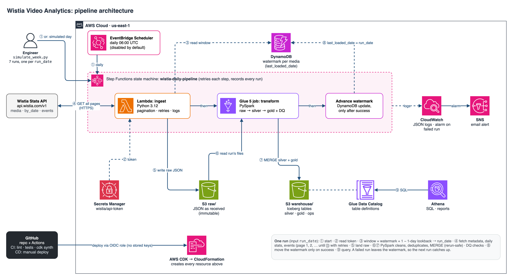
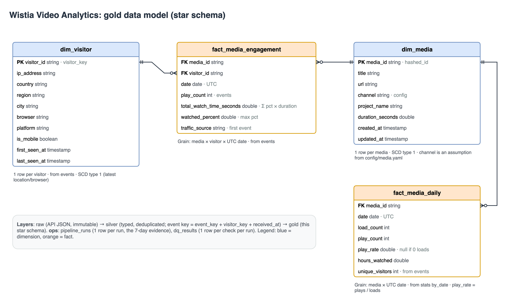

# Wistia Video Analytics Pipeline

End-to-end data engineering project: ingest media and visitor analytics from the Wistia Stats API,
transform them with PySpark into a dimensional model on AWS, and report on video engagement across
Facebook and YouTube.



**Daily run:** EventBridge Scheduler → Step Functions → Lambda (Python ingest, Wistia → S3 `raw/`) →
Glue 5.1 (PySpark: raw → silver → gold Iceberg tables, data-quality checks) → watermark advanced in DynamoDB →
query with Athena. Infrastructure is AWS CDK (Python); CI/CD is GitHub Actions.

## Results

Deployed to AWS (us-east-1) and run as a simulated 7-day production week (2026-03-17 → 2026-03-23, plus a rerun of
2026-03-20): **8 of 8 runs succeeded, 39 events loaded, 0 duplicated keys after the rerun**, totals identical to the
API exploration. Full evidence: [docs/05_production_run](docs/05_production_run/README.md).

| Video | Channel | Plays | Visitors | Loads → plays (play rate) | Avg. watched |
|---|---|---|---|---|---|
| The Gap Method | Facebook | 28 | 24 | 53 → 26 (≈ 49%) | 30% |
| rivas_-_de_testimonial (1080p) (1) | YouTube | 11 | 10 | 1,620 → 11 (≈ 0.7%) | 23% |

The YouTube video is loaded 150–320 times a day but almost never played: the page it is embedded on, not the video,
is the first thing to look at. (Plays per video count events; the play-rate column uses Wistia's daily `play_count`,
which differs slightly; see the data-quality warning in the evidence.)

## Requirements coverage

| ID | Requirement | How it is met |
|---|---|---|
| FR1 | Own architecture, approved by the SME | [Design](docs/02_design/README.md), approved 2026-11-04 |
| FR2 | Token authentication | Bearer token (Wistia's documented method; Basic also tested, see Step 1). Token in Secrets Manager, never in code |
| FR3 | Media metadata | `/medias/{id}.json` → `dim_media` (title, ids, url, channel, created/updated) |
| FR4 | Engagement metrics | `by_date` → `fact_media_daily` (loads, plays, play rate, hours); events → `fact_media_engagement` |
| FR5 | Visitor-level data | `/stats/events` → `dim_visitor` (IP, location, browser) and per-visitor engagement |
| FR6 | Pagination | Events are pulled page by page until Wistia returns an empty page (`src/wistia/api.py`) |
| FR7 | Incremental ingestion | Date window per media from a DynamoDB watermark, with a 1-day lookback for late events; `MERGE` upserts. Events have no `updated_at`, so the window uses the event date (`received_at`); media metadata (`updated`) is re-read every run |
| FR8 | 7 consecutive production days | **Simulated**: the deployed pipeline ran once per `run_date` for 7 consecutive days (decision 2026-11-03); the daily schedule exists but is disabled |
| FR9 | CI/CD with GitHub Actions | CI on every PR (lint, 50 unit tests, CDK template tests, `cdk synth`); manual Deploy workflow with OIDC (built; the deployment itself was run from the CLI) |
| FR10 | Structured data model | Iceberg star schema in the Glue Data Catalog: 2 dimensions, 2 facts, plus ops tables |
| FR11 | Reports / dashboard (optional) | Report queries in `sql/evidence.sql`, results in [docs/05_production_run](docs/05_production_run/README.md); no dashboard |
| FR12 | Repo with docs, code, CI/CD, instructions | This repository |

## Documents

| Step | Document |
|---|---|
| 0 | [Requirements (redacted)](docs/00_requirements/requirements.md) |
| 1 | [API exploration: endpoints, volume, findings](docs/01_api_exploration/README.md) |
| 2 | [Architecture and data model](docs/02_design/README.md) (approved by the SME 2026-11-04) |
| 4–5 | [Deployment and the simulated 7-day production run: evidence and results](docs/05_production_run/README.md) |
| — | [Decisions and change log](docs/decisions.md) |

## Repository layout

```
config/media.yaml          media in scope + channel mapping (Facebook / YouTube)
src/wistia/                the library
  api.py                   Wistia client: Bearer auth, retries with backoff, pagination
  ingestion.py             incremental window + one ingestion run (extract -> land raw)
  storage.py, state.py     local raw folder and local watermark file
  aws/adapters.py          S3 storage, DynamoDB watermarks, Secrets Manager token
  aws/lambda_handlers.py   Lambda entry points: ingest, advance_watermarks
  transform/               PySpark: schemas, silver, gold, quality (DQ checks), tables (Iceberg), pipeline
jobs/
  ingest.py                local ingestion  (Mac -> lake/raw)
  transform.py             local transform  (Glue Docker image -> lake/warehouse)
  glue_transform.py        AWS Glue job entry point
infra/                     AWS CDK app: WistiaPipeline stack + one-time GitHub OIDC deploy role
scripts/
  spark_local.sh           run a PySpark script in the AWS Glue 5.1 Docker image
  simulate_week.py         FR8: run the pipeline for 7 consecutive run_dates (AWS or --local)
  athena_query.py          run SQL in Athena (or --local) and print tables
  query_local.py           SQL against the local Iceberg tables
sql/evidence.sql           7-day evidence, DQ results, duplicate check, report queries
tests/                     unit tests (pytest; HTTP and AWS mocked, PySpark local)
.github/workflows/         ci.yml (every PR), deploy.yml (manual, OIDC)
```

## Data model



`raw` (API JSON, immutable) → `wistia_silver` (typed, deduplicated) → `wistia_gold`
(`dim_media`, `dim_visitor`, `fact_media_engagement`, `fact_media_daily`) + `wistia_ops`
(`pipeline_runs`, `dq_results`). All tables are Apache Iceberg; loads use `MERGE` on natural keys, so a rerun
never creates duplicates. Details: [design doc, section 3](docs/02_design/README.md#3-data-model).

## Setup (Mac, arm64)

Needs: [uv](https://docs.astral.sh/uv/), Docker Desktop, Java 11+ (for the PySpark unit tests),
and for AWS: the AWS CLI and the CDK CLI (`npm install -g aws-cdk`).

```bash
cp .env.example .env            # then set WISTIA_API_TOKEN in .env (never commit it)
uv sync                         # creates .venv with the library and dev tools
docker pull public.ecr.aws/glue/aws-glue-libs:5.1.0
uv run pytest -q                # unit tests
uv run ruff check . && uv run ruff format --check .
```

## Run locally (no AWS)

```bash
uv run python jobs/ingest.py --run-date 2026-03-17                 # Wistia -> lake/raw
scripts/spark_local.sh jobs/transform.py --run-date 2026-03-17 \
  --media-config "$(uv run python -m wistia.config)"               # lake/raw -> lake/warehouse
uv run python scripts/simulate_week.py --start 2026-03-17 --days 7 --rerun 2026-03-20 --local
uv run python scripts/athena_query.py sql/evidence.sql --local      # evidence + reports
```

Start from scratch with `rm -rf lake` (the local lake is git-ignored).

## Deploy to AWS

You run these yourself; each one creates or changes resources in your account (region `us-east-1`).

```bash
aws sts get-caller-identity                              # 1. check you are logged in to the right account
cdk bootstrap aws://<ACCOUNT_ID>/us-east-1               # 2. once per account/region (CDK's own bucket and roles)
set -a; source .env; set +a                              # 3. store the Wistia token in Secrets Manager (once)
aws secretsmanager create-secret --name wistia/api-token --secret-string "$WISTIA_API_TOKEN" --region us-east-1
cd infra && cdk deploy WistiaPipeline -c alert_email=<you@example.com>   # 4. the pipeline (~3 min)
```

Confirm the SNS subscription email to get failure alerts.

**Simulated 7-day production run (FR8):** the daily schedule is created **disabled**; instead the deployed
pipeline runs once for each day from 17 to 23 March 2026, then 20 March again to show a rerun adds no duplicates:

```bash
uv run python scripts/simulate_week.py --start 2026-03-17 --days 7 --rerun 2026-03-20
uv run python scripts/athena_query.py sql/evidence.sql
```

**Teardown:**

```bash
cd infra && cdk destroy WistiaPipeline
aws secretsmanager delete-secret --secret-id wistia/api-token --force-delete-without-recovery --region us-east-1
```

`cdk destroy` leaves the log groups that Glue created itself (`/aws-glue/jobs/*`); delete them with
`aws logs delete-log-group`. To remove CDK's bootstrap too, delete the `CDKToolkit` stack, then its assets bucket
`cdk-hnb659fds-assets-<account-id>-us-east-1`, which is retained and versioned (delete all object versions first).

## CI/CD (GitHub Actions)

- **CI** (`.github/workflows/ci.yml`) on every pull request and push to `main`: ruff lint/format, unit tests
  (including PySpark), CDK template tests and `cdk synth`.
- **Deploy** (`.github/workflows/deploy.yml`), started by hand from the Actions tab, `main` only: tests, then
  `cdk deploy`. AWS access is OIDC (no AWS keys stored in GitHub). One-time setup:
  1. `cd infra && cdk deploy WistiaGithubOidc` (add `-c create_oidc_provider=false` if the account already has a
     GitHub OIDC provider).
  2. Add the `DeployRoleArn` output as the repository secret `AWS_DEPLOY_ROLE_ARN`.
  3. Create the environment `production` (Settings → Environments), optionally with a required reviewer.

## Cost

Under $1 for the simulated week (Glue ≈ $0.03 per run; Lambda, Step Functions, DynamoDB, S3 and Athena are
within cents). Idle: ~$0.40/month for the secret.
