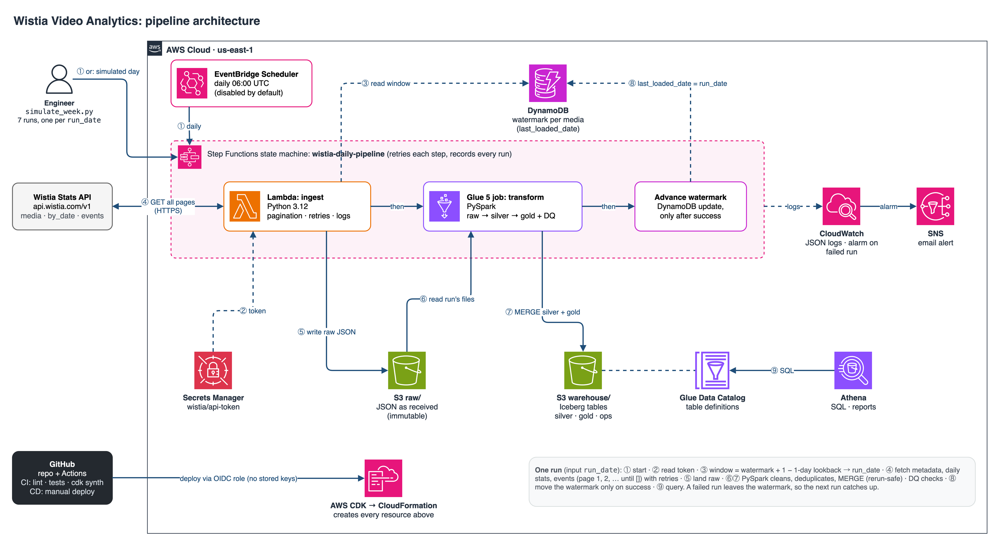
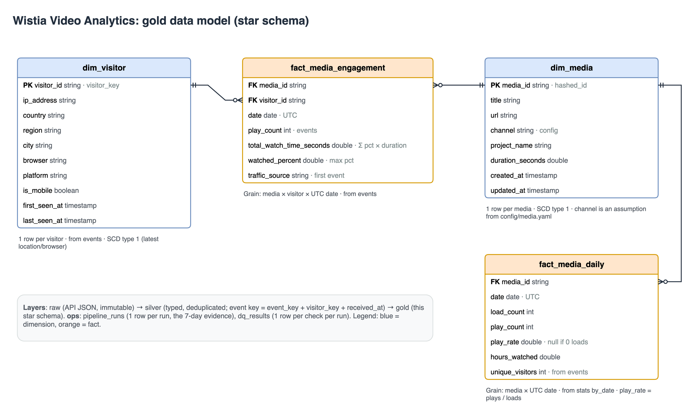

# Step 2: Architecture and data model

Status: **approved 2026-11-03** by the user; **approved by the SME 2026-11-04**, including the 4 points in section 3 and the
speaker notes (play rate in `fact_media_daily`, channel mapping, Bearer auth, simulated 7-day run).
Inputs: [requirements](../00_requirements/requirements.md), [Step 1 API findings](../01_api_exploration/README.md).

## 1. Architecture

Source: [`architecture.drawio`](architecture.drawio) (open in draw.io / diagrams.net to edit, then File → Export as PNG, 200%).

| Part | AWS service | Why this one |
|---|---|---|
| Schedule | EventBridge Scheduler | Serverless cron, ~free. Created **disabled** by default; the 7-day run is the simulation (decision 2026-11-03) |
| Orchestration | Step Functions (standard) | Runs ingest → transform in order, retries each step, records every run with its input (`run_date`), alerts on failure. ~free at 1 run/day; Airflow (MWAA) would cost ~$0.49/h |
| Ingestion | Lambda, Python 3.12, arm64 | Small data (≈30 API calls, <1 min per run); fits Lambda limits; no server to manage |
| Secret | Secrets Manager | Token never in code, Git, env files or logs. The user creates the secret once from the CLI |
| Incremental state | DynamoDB (on-demand) | One item per media: last successfully loaded date. Consistent writes, ~free |
| Raw storage | S3 `raw/` | Immutable API responses as received, so any day can be reprocessed without calling Wistia again |
| Transformation | Glue 5.1 job (PySpark 3.5), G.1X × 2 (was 5.0; see decisions 2026-11-04) | Required PySpark; serverless; ~1–2 min per run (≈$0.03) |
| Tables | Apache Iceberg on S3 + Glue Data Catalog | `MERGE` upserts make reruns idempotent (no duplicates); Athena reads them directly |
| Query / reports | Athena | SQL over the gold tables; dashboard choice in Step 6 |
| Monitoring | CloudWatch Logs (JSON lines), alarm on failed executions → SNS email | See every run; get an email when one fails |
| Infrastructure | AWS CDK (Python) | Whole stack in code: `cdk deploy` / `cdk destroy` |
| CI/CD | GitHub Actions | PR: lint + unit tests + `cdk synth`. Deploy: manual workflow with approval, AWS access via OIDC (no stored AWS keys) |

Region us-east-1. Estimated cost: **under $1 for the 7-day simulation**, ~$0.40/month idle (the secret), so the stack can stay
deployed until grading.

## 2. One run, step by step

Input: `run_date` (a day, UTC). For each media ID in `config/media.yaml`:

1. **Window.** Read the media's watermark from DynamoDB (`last_loaded_date`).
   `start = last_loaded_date + 1 day − lookback (1 day)`; `end = run_date`. First run (no watermark): `start = run_date`.
   The 1-day lookback re-reads the previous day to catch events that arrived late; the upsert in step 5 makes that safe.
2. **Extract** (Lambda), with retries (exponential backoff on 429/5xx/timeouts, max 5 tries) and a JSON log line per call:
   - `GET /medias/{id}.json`: metadata, every run (1 record; change detected by `updated`).
   - `GET /stats/medias/{id}/by_date.json?start_date&end_date`: daily loads/plays/hours.
   - `GET /stats/events.json?media_id&start_date&end_date&per_page=100&page=N`, N = 1, 2, … until an empty page `[]` (FR6).
3. **Land raw** in S3, one file per API response, never overwritten:
   `raw/wistia/<endpoint>/media_id=<id>/run_date=<date>/run_id=<id>/page_0001.json`, wrapped with metadata
   (`run_id`, `request_url`, `fetched_at`, `window_start`, `window_end`).
4. **Transform** (Glue PySpark) reads this run's raw files → **silver** (typed, cleaned, deduplicated) → **gold** (star schema),
   `MERGE` on natural keys, so rerunning a day gives the same result.
5. **Data-quality checks** (results in `ops.dq_results`): not-null keys, unique keys, `percent_viewed` within 0–1, every fact
   row has a media and visitor dimension row, row counts per run. A failed critical check fails the run.
6. **Advance the watermark** to `run_date` (a final Step Functions task writes DynamoDB) only after the transform and checks
   succeed. The Glue job writes a row to `ops.pipeline_runs` (run_id, run_date, window, rows per table, duration, status).

**Simulated 7-day run (FR8):** `scripts/simulate_week.py --start 2026-03-17 --days 7` starts the deployed Step Functions
pipeline 7 times in order (`run_date` = 17 … 23 March 2026) and waits for each. Each run loads only its new day (plus the
lookback). Evidence = `ops.pipeline_runs` (7 rows) + the Step Functions run history. A rerun of one day is shown to create no
duplicates.

## 3. Data model

Layers: **raw** (JSON as received) → **silver** (clean, one row per real-world thing) → **gold** (star schema for reports).
All timestamps UTC; the business date is the UTC date (Wistia's date filters use it, Step 1 finding 2).

### Silver

| Table | Grain / key | Notes |
|---|---|---|
| `silver.media` | `media_id` | Latest metadata; `channel` added from `config/media.yaml` |
| `silver.media_daily_stats` | `media_id, date` | From `by_date` |
| `silver.events` | `event_key, visitor_key, received_at` | `event_key` alone is **not** unique (Step 1 finding 3). Adds `event_date`, `traffic_source` |

`traffic_source` from `embed_url`: `facebook_ad` if it contains `fbclid`, `fbc_id` or `utm_source=meta`; `website` if any other
URL; `direct` if empty.

### Gold (star schema)

Source: [`data_model.drawio`](data_model.drawio).

| Table | Grain | Rules |
|---|---|---|
| `dim_media` | 1 row per media | Overwritten with latest values (SCD type 1) |
| `dim_visitor` | 1 row per visitor | Location/browser from the visitor's latest event; `first_seen_at` kept from the earliest (SCD type 1) |
| `fact_media_engagement` | media × visitor × date | `play_count` = number of events; `total_watch_time_seconds` = Σ `percent_viewed` × `duration`; `watched_percent` = max `percent_viewed`; `traffic_source` = from the visitor's first event that day |
| `fact_media_daily` | media × date | From `by_date`; `play_rate` = `play_count` / `load_count` (null when 0 loads); `unique_visitors` from events |
| `ops.pipeline_runs`, `ops.dq_results` | 1 row per run / per check per run | Evidence and monitoring |

**Changes from the requirements' simplified model:** `play_rate` moved to `fact_media_daily`, because
Wistia reports loads per media per day only, not per visitor. `fact_media_daily` is added. Extra descriptive columns are added
to both dimensions. `channel` is an assumption from config: `9k4tbcdfg0` = Facebook, `8hunphufxp` = YouTube.

## 4. Environments, security, operations

- **local:** ingestion runs on the Mac and writes to `lake/` (git-ignored); PySpark runs in the AWS Glue 5.1 Docker image; same
  code, switched by `PIPELINE_ENV=local|prod`.
- **prod:** the AWS stack above. Least-privilege IAM roles per component; S3 bucket private, encrypted, public access blocked.
- Personal data (IP, city) only in the private bucket; the public repo holds masked samples only.
- Failure handling: Step Functions retries each step twice; a failed run leaves the watermark unchanged, so the next run
  picks up the missed days automatically.

## 5. Build order (Step 3), the way the code grows

Each stage is one commit, so the history shows how a real engineer gets from a script to a production system.

| Stage | What | Runs where |
|---|---|---|
| 3.1 | `ingest.py`: one file, one API call, prints the result | Mac |
| 3.2 | Same file: all endpoints, pagination, retries, logging, writes raw JSON files | Mac → `lake/raw` |
| 3.3 | Same file: `run_date`, incremental window, watermark (local JSON file) | Mac |
| 3.4 | Refactor: reusable parts → library `src/wistia/` (config, logging, API client, storage, state); script becomes thin | Mac |
| 3.5 | Unit tests (pytest, HTTP mocked) | Mac |
| 3.6 | `transform.py`: one PySpark file, raw → silver → gold | Glue Docker |
| 3.7 | Refactor: pure transform functions + DQ checks into the library; unit tests | Glue Docker |
| 3.8 | Cloud adapters: S3 storage, DynamoDB state, Secrets Manager; Lambda handler; Glue job entry point | Mac (tests) |
| 3.9 | CDK stack: S3, DynamoDB, Lambda, Glue, Step Functions, Scheduler, alarm | `cdk synth` |
| 3.10 | GitHub Actions: CI on every PR, manual deploy workflow | GitHub |
| 3.11 | `scripts/simulate_week.py` + run evidence queries | AWS (Step 5) |
